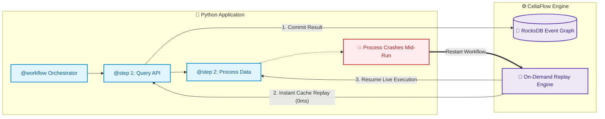
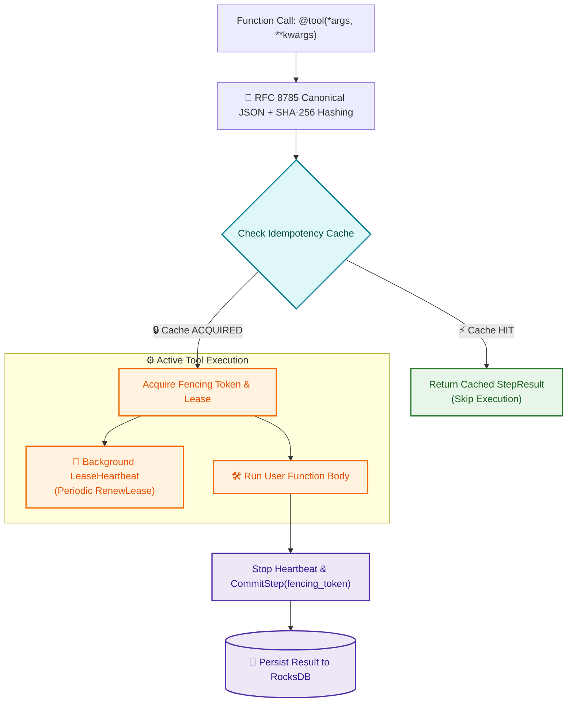

# Cellaflow Python SDK

The official Python SDK for the [CellaFlow Engine](https://www.cellaflow.com) — providing durable execution, deterministic replay recovery, and swarm-safe concurrency primitives for AI workflows and multi-agent systems.

[](https://github.com/cellaflow/cellaflow-sdks/actions/workflows/ci.yml)
[](https://github.com/cellaflow/cellaflow-sdks/actions/workflows/ci.yml)
[](https://pypi.org/project/cellaflow/)
[](https://pypi.org/project/cellaflow/)
[](https://github.com/cellaflow/cellaflow-sdks/blob/main/LICENSE)

---

## Features

- 🔄 **Durable Execution & Transparent Replay**: Workflows survive process restarts and infrastructure crashes without re-executing completed steps.
- ⚡ **Zero-Friction Decorators**: Annotate standard Python functions with `@workflow`, `@step`, and `@tool` (supporting both `def` and `async def`).
- 🧠 **LangGraph Drop-in Checkpointer**: Native `CellaflowSaver` checkpointer for LangGraph workflows with immutable MessagePack state snapshots, time-travel, and crash recovery.
- 💳 **Leased Tool Calls Inside LangGraph Nodes**: `durable_tools` leases a node's irreversible side effect, such as placing an order, so a resumed or concurrent run of the same thread reuses its recorded result instead of performing it again. A checkpointer makes your state durable; this makes your *side effects* durable.
- 🛡️ **Deterministic Idempotency**: Automatic input hashing via RFC 8785 Canonical JSON and SHA-256 guarantees cross-language determinism across multi-agent swarms.
- 🤝 **Cross-Session Coordination**: `SCOPE_SHARED` lets heterogeneous agents — different workflows, different sessions, different versions — converge on a single execution of a shared side effect.
- 🔒 **Background Lease Management**: Non-blocking heartbeat management keeps engine locks alive and eliminates split-brain execution using fencing tokens.
- 📦 **Secure Serialization**: Strictly uses MessagePack for all state payloads to optimize throughput over gRPC and eliminate Remote Code Execution (RCE) deserialization vectors.

---

## Installation

### Core SDK
For standard durable execution workflows, decorators, and gRPC client:
```bash
pip install cellaflow
```

### With LangGraph Support
To use `CellaflowSaver` as a drop-in LangGraph checkpointer:
```bash
pip install "cellaflow[langgraph]"
```

> **Note on Optional Dependencies**:
> - `pip install cellaflow` installs a lightweight package without pulling in LangGraph, Pydantic, or LangChain.
> - If your environment already contains `langgraph >= 0.2.0` and `langgraph-checkpoint >= 2.0.0`, `from cellaflow import CellaflowSaver` will work immediately out of the box.
> - Installing `cellaflow[langgraph]` ensures that compatible `langgraph` and `langgraph-checkpoint` versions are installed or upgraded automatically.

---

## Quickstart

### 1. Synchronous Workflow

```python
from cellaflow import workflow, step, tool, IdempotencyScope

# 1. Define tools with automatic caching and idempotency
@tool(scope=IdempotencyScope.SCOPE_SESSION_WIDE)
def search_web(query: str) -> dict:
    """Simulates an expensive API or web search tool."""
    print(f"Executing web search for: {query}")
    return {"query": query, "results": ["CellaFlow Overview", "Durable Execution Docs"]}

# 2. Define intermediate steps
@step
def summarize_results(data: dict) -> str:
    return f"Processed {len(data['results'])} items for '{data['query']}'"

# 3. Define the orchestrating workflow
# By default connects to localhost:50051 (or pass custom target="engine:50051", secure=True)
@workflow(version="1.0.0")
def research_workflow(topic: str) -> str:
    search_data = search_web(topic)
    summary = summarize_results(search_data)
    return summary

if __name__ == "__main__":
    result = research_workflow("autonomous agent architectures")
    print("Result:", result)
```

---

### 2. Asynchronous Workflow & Multi-Agent Swarms

The SDK natively supports `async def` coroutines, asynchronous I/O, and agent isolation:

```python
import asyncio
from cellaflow import workflow, step, tool, IdempotencyScope

@tool(agent_id="researcher_agent", scope=IdempotencyScope.SCOPE_AGENT_PRIVATE)
async def fetch_market_data(ticker: str) -> dict:
    print(f"Fetching live ticker data: {ticker}")
    await asyncio.sleep(0.5)  # Simulate non-blocking async network I/O
    return {"ticker": ticker, "price": 142.50}

@step(agent_id="analyst_agent")
async def analyze_trends(market_data: dict) -> str:
    return f"Signal for {market_data['ticker']}: BUY at ${market_data['price']}"

@workflow(version="1.0.0")
async def swarm_analysis_workflow(ticker: str) -> str:
    data = await fetch_market_data(ticker)
    analysis = await analyze_trends(data)
    return analysis

if __name__ == "__main__":
    result = asyncio.run(swarm_analysis_workflow("CELL"))
    print("Analysis Result:", result)
```

---

### 3. Coordinating Agents Across Different Sessions

The scopes above deduplicate *within* one session. `SCOPE_SHARED` deduplicates *across* them: several
agents, each running its own workflow in its own session, converge on one execution of a shared
operation.

```python
from cellaflow import workflow, tool, IdempotencyScope

# Same tool_name, same arguments, same coordination_id -> same key.
@tool(tool_name="publish_release_notes", scope=IdempotencyScope.SCOPE_SHARED,
      shared_on=["version"])
def publish(version: str) -> dict:
    return notes_service.publish(version)   # runs once, however many agents call it

@workflow(version="1.0.0")
def coder_agent(version: str) -> dict:
    return publish(version)

@workflow(version="2.3.0")          # a different workflow, on a different version
def doc_writer_agent(version: str) -> dict:
    return publish(version)

# Different sessions, different workflows -- one publish.
coder_agent("v4.2", _coordination_id="release-4.2")
doc_writer_agent("v4.2", _coordination_id="release-4.2")
```

`_coordination_id` names **the work being shared** — a release, a ticket, a task, a tenant — and is
passed at the call site alongside `_session_id`, because it is a property of the collaboration and
not of the tool definition. The engine stores it with the session as the session's default
coordination domain, and records every step under it.

`shared_on` names the arguments that identify the shared work — here, the version being
published. **It is required** (or an explicit `idempotency_key`), and omitting it raises at import
rather than in production.

The reason is the point of the scope. Agents sharing a side effect will not agree on every
argument — that is what makes them different agents — so hashing all of their arguments gives each
one its own key and each performs the side effect. Naming the identifying arguments lets them
disagree about everything else and still converge.

Note the trade-off you accept by doing so: the agents that lose receive a result computed from
arguments they did not supply. If that matters, make the disputed value itself a leased step so
they agree on it before reaching the step that spends it.

`_coordination_id` is **required** for `SCOPE_SHARED` and has no built-in default; a shared call
with no domain raises `ValueError`. A built-in default would silently deduplicate unrelated callers
that happen to make the same call: one agent's operation is suppressed and it is handed a result it
never asked for, with no error raised anywhere. Making the domain explicit forces that boundary to be
a decision rather than an accident. The other scopes do not use it in their keys, though the engine
still records it on every step.

**Resuming keeps the domain.** A resumed session may omit `_coordination_id`: the stored value is
adopted, so the agent keeps deriving the same shared keys as the agents it was working with. Passing
a *different* one is refused with `FAILED_PRECONDITION`, and so is naming one on a session started
without one, because either would silently stop it deduplicating against its peers.

```python
coder_agent("v4.2", _session_id=sid)                                 # adopts "release-4.2"
coder_agent("v4.2", _session_id=sid, _coordination_id="release-4.3")  # grpc.RpcError
```

**Overriding the domain for one call.** A step can name its own domain by passing
`_coordination_id` when it is called. That one call is recorded under it and, under `SCOPE_SHARED`,
keyed by it, so it converges with any other agent using the same domain, whatever that agent's
session default:

```python
@tool(tool_name="place_order", scope=IdempotencyScope.SCOPE_SHARED, shared_on=["order_id"])
def place_order(order_id: str, total_cents: int) -> dict:
    return shop.place_order(order_id, total_cents)

@workflow(version="1.0.0")
def support_agent(ticket: str, order_id: str) -> dict:
    # Works the ticket, but places the order under the order's domain.
    return place_order(order_id, 2499, _coordination_id=order_id)

@workflow(version="1.0.0")
def checkout_agent(order_id: str) -> dict:
    return place_order(order_id, 2499)

support_agent("T-4417", "order-88", _coordination_id="T-4417")
checkout_agent("order-88", _coordination_id="order-88")   # one order, not two
```

The override is popped before your function is called. Compute it from the workflow's inputs, not
from anything that varies between runs, so a resumed run derives the same key.

A coordination id must not contain colons, must not have leading or trailing whitespace, and must
not exceed 256 bytes; an empty string means none. An invalid value raises `ValueError` before the
session starts or, for an override, before the step runs. It is never trimmed or otherwise cleaned
up, because it is hashed into the key exactly as given.

**Three things must match for two agents to converge.** All of them are under your control, and any
one of them being different means both agents execute:

| Must match | Note |
| --- | --- |
| `coordination_id` | The call's own, if it passes one, otherwise the session's. Different domains stay isolated. This is what keeps the scope from being too wide. |
| `tool_name` | Defaults to the *function name*. Agents whose functions are named differently must set `tool_name=` explicitly to the same value. |
| Arguments | Hashed with RFC 8785 + SHA-256, so `publish("v4.2")` and `publish("V4.2")` are different operations. |

The derived key drops both `session_id` and `workflow_version`:

```
shared:[coordination_id]:[tool_name]:[RFC8785_SHA256(args)]
```

Dropping the version is deliberate — heterogeneous agents will not be on the same workflow version,
and requiring them to be would defeat the purpose. The consequence is that **changing a shared tool's
behaviour without changing its name or arguments will not produce a new key**, so an agent on the new
version can receive a result produced by the old one. Encode the behaviour change in the arguments,
or in `tool_name`, when that matters.

**Waiting for another agent.** A call that another agent is already running waits for it in the
engine, not by polling. It gets that agent's result the moment it is recorded, or the lease the
moment it is released or lapses. The engine checks the holder every 100 ms on behalf of every caller
waiting on the call, and each waiting caller sends a new request about once every 10 s, rather than
once a second. An `async` step waits on the gRPC call itself, holding neither the event loop nor a
thread. A request that fails without an answer (no answer within 15 s, the engine unavailable, a
dropped connection) is asked again, and after three in a row the call fails, so a lost connection
to the engine is noticed. A proxy between the SDK and the engine must let a request run for at
least 15 s.

---

### 4. Transparent Replay & Session Recovery

To recover an interrupted execution after a process crash or restart, supply the `_session_id` keyword argument:

```python
# Resumes the workflow from the exact step where it stopped.
# Completed steps are loaded from the engine's event graph and returned with 0ms execution time.
recovered_result = research_workflow(
    "autonomous agent architectures", 
    _session_id="3f7491d9-e932-4467-bcda-370fb5c1a7e4"
)
```

> **The workflow body must be deterministic.** A resumed run has to call the same steps in the same order as the run it is recovering. Put anything that varies — model output, clocks, random values, network reads — *inside* a step, never in the code that decides which steps to call. See [Replay determinism](#replay-determinism) for why, and for the error you get if you break it.

---

### 5. LangGraph Checkpointer (`CellaflowSaver`)

Use `CellaflowSaver` as a drop-in checkpointer for any LangGraph `StateGraph`:

```python
from typing import TypedDict, List
from langgraph.graph import StateGraph, START, END
from cellaflow import CellaflowSaver

# 1. Initialize checkpointer connected to CellaFlow Engine
checkpointer = CellaflowSaver(target="localhost:50051", secure=False)

# 2. Define LangGraph state schema
class WorkflowState(TypedDict):
    query: str
    summary: str

def plan_node(state: WorkflowState) -> dict:
    return {"summary": f"Plan generated for {state['query']}"}

# 3. Build graph
builder = StateGraph(WorkflowState)
builder.add_node("plan", plan_node)
builder.add_edge(START, "plan")
builder.add_edge("plan", END)

# 4. Compile with CellaFlow persistence
app = builder.compile(checkpointer=checkpointer)

# 5. Execute with session tracking
config = {"configurable": {"thread_id": "session-42"}}
result = app.invoke({"query": "AI Agents"}, config)
print("Graph output:", result)

# 6. Time travel / inspect state history
for checkpoint_tuple in checkpointer.list(config):
    print("Checkpoint ID:", checkpoint_tuple.checkpoint["id"])
    print("State snapshot:", checkpoint_tuple.checkpoint["channel_values"])
```

---

### 6. Leased Tool Calls Inside LangGraph Nodes (`durable_tools`)

A checkpointer makes your graph's **state** durable. It does nothing for a
node's **side effects**: if a node places an order and the pod dies before the
next checkpoint lands, the resumed run re-enters that node and places it again.

`durable_tools` leases those side effects. Wrap the invocation, and any `@tool`
called inside a node body is leased per thread: a resumed run, or a concurrent
one on the same thread, gets the recorded result instead of running the tool
again.

```python
from cellaflow import CellaflowSaver, durable_tools, tool

@tool(tool_name="place_order")
def place_order(order_id: str, total_cents: int) -> dict:
    return shop.place_order(order_id, total_cents)   # irreversible

def order_node(state):
    return {"receipt": place_order(state["order_id"], state["total_cents"])}

app = builder.compile(checkpointer=CellaflowSaver(target="localhost:50051"))
config = {"configurable": {"thread_id": "thread-4417"}}

with durable_tools(config):
    app.invoke({"order_id": "ORDER-4417", "total_cents": 2499}, config)
```

If that process dies after the order is recorded and a new one resumes the
thread, LangGraph re-runs the pending node, the tool is reached a second time,
and the lease answers from the recorded result instead of calling the shop. One
order is placed. `examples/multi_agent_idempotency` scenario 5 runs exactly
this, killing the process after the leased call returns and before the node's
checkpoint lands.

**Use the context manager rather than assembling the equivalent yourself.** A
tool's idempotency key is derived from its session id, and `durable_tools`
derives that session from the thread — stable across restarts, so the lease
still recognises the earlier attempt, and separate from the checkpointer's own
session, so the two do not compete for positions in the graph. A tool called
outside `durable_tools` raises rather than running unleased.

#### Using it with the checkpointer you already have

`durable_tools` does not go through the checkpointer. It establishes the context
the `@tool` reads and talks to the engine directly, so leasing works with
whichever `BaseCheckpointSaver` you already use — adopting it does not mean
moving your checkpoint storage:

```python
from langgraph.checkpoint.postgres import PostgresSaver
from cellaflow import durable_tools, tool

with PostgresSaver.from_conn_string(DB_URI) as checkpointer:
    checkpointer.setup()
    app = builder.compile(checkpointer=checkpointer)

    with durable_tools(config):
        app.invoke({"ticket": "T-4417", "amount": 2499}, config)
```

Checkpoints go to Postgres exactly as before; the node's irreversible tool call
is leased. The same holds for `MemorySaver` or any other checkpointer.

#### Two nodes calling the same tool

Under the default `SCOPE_SESSION_WIDE` the key is derived from the tool name and
arguments, **not** the graph position — which is exactly what lets the guarantee
survive a resume, since LangGraph re-runs only the pending node and so reaches
tools in a different order.

The consequence: two *different* nodes calling the same `tool_name` with the same
arguments in one thread deduplicate into a single execution. Give them distinct
`tool_name`s, or an explicit `idempotency_key`, when they are genuinely different
operations.

#### When replicas disagree about the arguments

Worth knowing before relying on this. The derived key hashes the tool's
arguments, so two replicas that reach the same node with **different**
arguments derive different keys and do not contend — each is, as far as the
engine can tell, a distinct operation.

Passing an explicit key makes them converge:

```python
@tool(tool_name="place_order", idempotency_key=f"order-{order_id}")
```

That prevents the duplicate order, with a trade-off to state plainly: the replica
that loses receives a result computed from arguments it did not supply. If the
replicas disagreed about the total, the loser is handed an order placed at
someone else's total. The durable fix is to make the disputed value itself a
leased step, so they agree on it before reaching the step that places the order.

---

## Architecture & How It Works

### 1. Transparent Replay Recovery

If a worker crashes mid-workflow, restarting the workflow with the same session automatically recovers state from the CellaFlow engine's durable event log:



#### Replay determinism

Replay is **positional**. Each `@step` call increments a per-session counter, and a resumed run answers the step at sequence *N* from whatever was committed at sequence *N*. That is only sound if the resumed run performs the same steps in the same order as the original.

So the rule is: **the workflow body decides *what* to call deterministically; all nondeterminism lives inside step bodies.** A step's result is committed and replayed, so a value produced inside a step is stable across resumption. A value produced in the orchestrating code is not — it is recomputed on every resume, and if it changes, the branch taken changes with it.

```python
@workflow(version="1.0.0")
def triage(ticket_id: str) -> dict:
    # ❌ Nondeterministic branch: `llm.classify` runs afresh on every resume.
    # If it answers differently the second time, the run takes a different path
    # and every subsequent step lands on a sequence belonging to another step.
    if llm.classify(ticket_id) == "urgent":
        escalate(ticket_id)
    return resolve(ticket_id)


@workflow(version="1.0.0")
def triage(ticket_id: str) -> dict:
    # ✅ The classification is a step, so it is committed once and replayed.
    # Every resume branches on the same value the original run branched on.
    if classify(ticket_id) == "urgent":
        escalate(ticket_id)
    return resolve(ticket_id)
```

The same applies to any other varying input to a branch: `datetime.now()`, `random`, environment lookups, or a bare HTTP call. Wrap it in a `@step` or `@tool` and branch on the result.

#### Failed steps replay too

A step that raised, and that the workflow carried on past, is recorded at its position like any other step. A resumed run raises the same exception there instead of running the step again, so the workflow takes the same branch it took the first time.

- **The exception is rebuilt from what was recorded:** its class, arguments and fields. None of the class's own code runs to do it. The original traceback is attached as a note.
- **A field that could not be recorded** (an open connection, a response object) comes back as a placeholder. Using it raises `AttributeError` saying it was not recorded. When the failure happens, the SDK logs a warning naming each such field. `AttributeError.obj`, which Python fills with a live object, is replayed the same way without a warning.
- **Exception groups** keep every member's type and message, so `except*` matches the same members. A group with more than 2,000 members, or too large to record even member by member, cannot be replayed: the SDK warns when it happens, and a resume stops at that position.
- **A cancelled async step is recorded, but not replayed.** The record fills the position, so the workflow's next step lands where it should, and it is written even when nothing follows, so re-running a finished session to read its result refuses there too: read the session's history instead. A resume refuses there with `FailureNotReplayableError`, because what the workflow saw depended on what cancelled the step, which the record cannot say: `asyncio.wait_for` around the step turns its own cancellation into `TimeoutError`, while one from outside arrives as `CancelledError`. Waiting for the same thing to happen again cannot tell them apart either, because earlier steps replay instantly and move every timer. **Put the timeout inside the step's body** (`return await asyncio.wait_for(call(), 5)`): the step then raises `TimeoutError` itself, which is recorded and replays exactly.
- **The exception is recorded as the step raised it,** before the workflow's handler runs, so a handler that changes it (`e.attempts += 1`) finds the original values on replay too. Fields in `__slots__` are recorded too.
- **A refusal stops the run, even if the workflow catches it.** A recorded failure is raised inside the workflow's own `try`, so a broad `except Exception` there would catch `FailureNotReplayableError` or `ReplayDivergedError` and carry on. After a refusal, every later step raises it again before its body runs, and the workflow raises it when it ends.

A failure the workflow lets propagate is not recorded, so a resume runs the step again. The exception is a step that runs while the failure is still propagating: a cleanup in a `finally`, or in an `except` that re-raises. That step needs the next position, so the failure is recorded to fill the one before it, and a resume then replays both and ends with the same exception rather than running the failed step again. The run logs a warning when this happens; to run the step again, start a new session. An async run interrupted with Ctrl-C reaches the running step as a cancellation; with a cleanup step after it, the cancellation is recorded, and a resume refuses there.

Define the exceptions a step raises at module level, in a module the workflow imports. A class defined inside a function, or only in the script being run, cannot be found by a resumed process. Nor can one from a library the step imports inside its own body (`import stripe` inside the tool): a resume does not run the step, so it does not run that import, and the SDK never imports anything itself on replay. Import such libraries where the workflow is defined. The SDK warns about all three when the failure is recorded.

#### When a resume cannot go on

A resumed run that cannot reproduce its history stops before the step does anything. Both errors below derive from `NondeterministicWorkflowError`; catch that to handle either.

**`ReplayDivergedError`**: the resumed run called a different step than the history records at that position.

```
ReplayDivergedError: Session sess-4417 cannot resume at position 3. The resumed
run called 'notify', but the history records 'fallback' there.
Position 2 ('charge') failed with PaymentDeclined on the first run; after it, the
code took a different branch than it did then.
Common causes: the workflow code changed since the first run (a step added,
removed or reordered, or a different timeout), or it branched on something not
recorded (the clock, a random number, a model's answer outside a step). Nothing
ran twice. To go on, start a new session for this work.
```

**This is a bug in your workflow, not in the engine.** The resumed run took a different path than the run it is recovering, most often because of a branch on a value computed outside a step. Find the branch named in the error, and move whatever it tests into a step. The check compares step names, which catches a changed *shape* of execution: a skipped branch, a reordering, an extra step.

**`FailureNotReplayableError`**: the history records a failure or cancellation at this position, and the resumed run cannot reproduce it exactly. Raising a different exception could send the run down a different branch, so it stops instead.

```
FailureNotReplayableError: Cannot replay the failure of 'charge' at position 2:
its exception type stripe._error:CardError is in module stripe._error, which this
process has not imported. A resume does not run a step's body, so an import
inside the step does not happen. Add `import stripe._error` where the workflow is
defined, then resume this session again: nothing has run twice, and it resumes
from here.
```

That one is fixed by the import it names, and the same session then resumes. Other causes need a new session: the exception's class is defined inside a function or was renamed, the class can only be built by an extension module's compiled code (pydantic's `ValidationError`), the failure was recorded by the TypeScript SDK, the exception group was too large to record, or the step was cancelled as an async step and is now synchronous.

In every case nothing ran twice, and the session's history is unchanged.

A related error, `Cannot verify replay at sequence N: the recorded step has no name`, raised as `NondeterministicWorkflowError` itself, means the history was not written by this SDK. Every step it commits records a name, so a nameless record cannot be checked and is refused rather than replayed positionally.

Extending history is fine and is the normal case: a run that matches the recorded prefix and then continues past it executes the new steps and commits them as usual. Only *divergence within* the recorded prefix raises.

#### `DivergentStepError`

Different failure, different cause. This one is about **concurrent replicas**, not replay.

Two replicas of one agent reach the same step with *different* arguments — an LLM computing
`2499` in one and `3000` in the other. Different arguments hash to different idempotency keys, so
the engine sees two unrelated operations and neither blocks the other. The only thing they share
is the graph position they both intend to write.

The engine refuses the second one **before its body runs**:

```
DivergentStepError: Step 'place_order' at sequence 1 was refused: Sequence 1 in
session 'session-4417' is already committed; the session is at 1. The lease was
refused before execution because this position already holds a different step...
```

**The fix belongs in the workflow.** Wrap whatever the replicas disagreed about in its own step,
so they converge on one value before reaching the step that acts on it:

```python
@tool
def decide_total(order_id: str) -> int:
    return llm.price(order_id)        # nondeterministic, but leased -> one winner

@tool
def place_order(order_id: str, total_cents: int) -> dict:
    return shop.place_order(...)      # now sees identical arguments in every replica
```

One replica wins the lease on `decide_total` and the rest receive its result from cache, so every
replica calls `place_order` with identical arguments and identical keys, and takes the ordinary
cache-hit path instead of a refusal.

---

### 2. Idempotency & Lease Lifecycle

For external tool calls and multi-agent coordination, `@tool` prevents duplicate tool calls, single-flights in-progress work, and maintains active lock heartbeats:



---

## Core Concepts

### Authenticating with the engine

An engine started with a token refuses calls without it. Start the engine with the token in `CELLAFLOW_API_KEY`, set the same variable in the SDK's environment, and every call sends it, with no code change:

```bash
export CELLAFLOW_API_KEY=your-engine-token
```

Or pass it explicitly. Every entry point that talks to the engine takes `api_key`: `@workflow`, `durable_tools`, `execution_lease`, `async_execution_lease`, `task_lease`, `CellaflowSaver` and `CellaflowClient`.

```python
@workflow(version="1.0.0", target="engine.example.com:50051", secure=True, api_key=key)
```

- **Where it comes from:** `api_key` if given, else `CELLAFLOW_API_KEY`. A blank value means no key. That is the only variable the SDK reads. It never reads the engine's older name, `CELLAFLOW_AUTH_TOKEN`, or the generic `AUTH_TOKEN` and `API_KEY`: a variable that generic often holds another service's secret.
- **On the engine:** the engine reads its token from `CELLAFLOW_AUTH_TOKEN` before `CELLAFLOW_API_KEY`, and a blank `CELLAFLOW_AUTH_TOKEN` counts as set: the engine then has no token at all. Leave `CELLAFLOW_AUTH_TOKEN` unset there, not blank (Compose writes a blank one for `${VAR}` when the variable is unset), and set only `CELLAFLOW_API_KEY`.
- **How it's sent:** as `authorization: Bearer <key>` on every call.
- **Kept out of sight:** the SDK never puts the key in a log message, an exception message or a `repr`. grpc's own stack frames do hold the outgoing header, so a tool that records a traceback's local variables (loguru's `diagnose`, Sentry's frame variables, `pytest -l`) can show it. Turn that off wherever the key matters.
- **Refused early:** a key that cannot be sent as a header (surrounding whitespace, or a character outside printable ASCII) is refused before a connection opens, naming where it came from. A decorator given one refuses it when it is applied; whether a key may go without TLS is decided when each call builds its client, so an opt-in set after import still counts.
- **Without TLS:** a key is never sent in plaintext to anything but this machine unless you allow it. With `secure=False` and another host as the target, the client refuses, naming the target, so forgetting TLS cannot be how a key crosses the network. On a network you trust (a Compose network, a Kubernetes service), set `CELLAFLOW_ALLOW_PLAINTEXT_KEY=true` (or, building a `CellaflowClient` yourself, pass `allow_plaintext_key=True`); each target then logs a warning once. A target on this machine is checked by gRPC as well as by name: the channel bypasses any `https_proxy`, and refuses a connection whose peer is not this machine, so a name that only looks local fails to connect rather than send the key. That failure is gRPC's UNAVAILABLE, "Endpoint is neither UDS or TCP loopback address": the name resolved somewhere other than this machine, and the opt-in does not override it. Use the machine's real address, or TLS. An allowed remote target still goes through `https_proxy` if one is set, so the key crosses the proxy too; add the engine's host to `no_proxy` (or `no_grpc_proxy`) if that matters.
- **Your own CA:** `secure=True` trusts the public root certificates gRPC ships with. For an engine whose certificate comes from your own CA, or is self-signed, set `GRPC_DEFAULT_SSL_ROOTS_FILE_PATH=/path/to/ca.pem`, which gRPC then trusts instead.

### When the org is over its allowance

A hosted Cellaflow engine refuses new work from an org that has used up its allowance (its free steps, say) until the allowance resets. The SDK raises that refusal as `AllowanceExceeded`, at once, wherever the call was made: a `@workflow` or `durable_tools` session start, a `@tool` or `@step` call, an `execution_lease`, `CellaflowSaver` or `CellaflowClient`. Nothing in the SDK loops or waits on the refusal: until the reset, the engine gives the same answer. Only a refused release, and the lease on a record the SDK keeps pending, are sent again, once, by your next call.

```python
from cellaflow import AllowanceExceeded

try:
    checkout(order, _session_id=order.id)
except AllowanceExceeded as e:
    # e.subject:   what the allowance is for, such as "cellaflow.steps"
    # e.resets_at: when it resets, a UTC datetime, or None if the engine did not say
    # e.limit:     what is blocked until then, "new_sessions_blocked" or "writes_blocked", or None
    retry_later(order, at=e.resets_at)
```

- **It is still a `grpc.RpcError`:** `code()` is RESOURCE_EXHAUSTED and `details()` the engine's message, so code that catches gRPC errors catches it too. Its message says the org is over its allowance, for what, and when it resets. A plain RESOURCE_EXHAUSTED, such as a session's full mailbox, is still retried as before; only one carrying the engine's allowance details is final.
- **A step it stops is not recorded as failed.** The refusal says nothing about the step, so a resume does not raise it again: running the workflow again with the same `_session_id` after the reset runs that step. Its position is given back when no later one has been claimed meanwhile, even with a step that called it still running (the refusal then stops that step too, and its position is given back next), so a workflow that catches the refusal and calls the step again later puts it where it would have been. A position below a later one still in flight is vacated instead: the counter steps down through it if the later one is given back too, or a call claims it again, and while it stays empty the run records nothing into the session, as when a failure overlaps another call. A step whose commit, sent again, is refused this way keeps its position, in case the first commit landed, and the run stops recording into the session. The same goes for an error a step body makes from the refusal (`raise OrderFailed(...) from e`) or an exception group holding it: the caller gets that error, and nothing is recorded.
- **The SDK's own records wait for the reset.** A cache hit's result or a caught failure that the SDK records when the next step starts stays pending, and that step raises `AllowanceExceeded`; the first call after the reset writes it. So does a failed step's lease the engine would not release: it is released then, with the record. One recorded as the workflow returns is dropped with a warning, so a re-run runs that step again.
- **A refused renewal stops the renewals, not the lease.** The engine holds the lease until its deadline, so a body that finishes in time commits as usual. At the deadline it is lost, as any lease whose renewals stop: `on_lease_lost` runs, an `async_execution_lease` caller is cancelled, and `check()` raises `LeaseLostError` saying the org is over its allowance, with the `AllowanceExceeded` as its `__cause__`. Only when the refusal is why the lease was lost: a holder that stalled past its deadline first gets the plain loss. A `@tool` or `@step` body that meets that loss fails the call with the `AllowanceExceeded` itself.

### `@workflow(version="1.0.0", target="localhost:50051", secure=False, api_key=None)`
Marks the entry point for a durable workflow execution:
- **Automatic Client Management**: Transparently initializes the underlying gRPC client and session state.
- **Context Isolation**: Uses Python's `contextvars` to manage session context safely across async event loops and threads.
- **Replay State Loader**: Loads completed step history from the engine whenever `_session_id` is supplied.
- **Call-time keyword arguments**: `_session_id` resumes an existing session; `_coordination_id` sets the session's default coordination domain, which every step is recorded under and `SCOPE_SHARED` keys are derived from. On resume it may be omitted, and the stored value is adopted. Both are popped before your function is called.

### `@step` and `@tool`
Decorators for atomic units of execution within a workflow:
```python
@step(
    idempotency_key: Optional[str] = None,
    agent_id: str = "default",
    tool_name: Optional[str] = None,
    scope: IdempotencyScope = IdempotencyScope.SCOPE_SESSION_WIDE,
    shared_on: Optional[Sequence[str]] = None,
    lease_ttl_ms: Optional[int] = None,
)
```
- **Idempotency Key Derivation**: Automatically builds a deterministic key using:
  `[Session_ID]:[Workflow_Version]:[Step_Sequence]:[Agent_ID]:[Tool_Name]:[RFC8785_SHA256_Hash]`
  — except under `SCOPE_SHARED`, which drops the session and version entirely, and hashes only
  the arguments named in `shared_on`:
  `shared:[Coordination_ID]:[Tool_Name]:[RFC8785_SHA256_Hash]`
- **Coordination override**: Passing `_coordination_id` when calling a step records that call under its own coordination domain instead of the session's, and derives its `SCOPE_SHARED` key from it. It is popped before your function is called.
- **Replay Interception**: If a step was already completed in the session history, immediately returns the cached output without re-running the function body.
- **Lease Heartbeating**: Automatically runs background heartbeats (`RenewLease`) via daemon threads (sync) or asyncio tasks (async) to keep engine locks refreshed.
- **Lock Release on Failure**: If an unhandled exception occurs, automatically releases the lease with `reason="TOOL_ERROR"`.
- **Lease TTL**: `lease_ttl_ms` sets how long the call's lease lasts without a renewal. See [How long a step's lease lasts](#how-long-a-steps-lease-lasts).

> **A lease is only as durable as its session.** The key is derived from the session id, and
> `@workflow` generates a fresh session per call unless you pass `_session_id` — so without a
> stable session id, a `@tool` deduplicates *within* a run but not across a restart. If you want a
> resumed run to reuse a side effect's result rather than repeat it, pass a stable
> `_session_id`. Inside LangGraph, use `durable_tools`, which derives one from the thread.

### How long a step's lease lasts

While a step's body runs, the call holds a lease, renewed every quarter of its TTL. If the process crashes or freezes, another caller can take the call over once the lease lapses: one TTL after the holder's last renewal. By default that is the engine's TTL, 20 s on current engines. Set `lease_ttl_ms` to change it, for every `@tool` and `@step` in a `durable_tools` block or for one of them:

```python
@tool(lease_ttl_ms=6_000)
def charge_card(order): ...

@tool
def send_receipt(order): ...

with durable_tools(config, lease_ttl_ms=10_000):
    charge_card(order)   # 6 s: the tool's own lease_ttl_ms wins
    send_receipt(order)  # 10 s: the block's
```

A shorter TTL means a faster takeover, and more renewals while a call runs. A holder that stops renewing for one TTL while its body still runs (a long garbage-collection pause, a process stopped by the OS, a lost connection to the engine) is taken over too, so set the TTL well above the longest pause a call can see. The TTL that decides a takeover is the holder's: a waiting caller's own `lease_ttl_ms` does not shorten it. A waiting caller waits in the engine, which grants it the lease as soon as it sees the lease lapse (it looks every 100 ms). The lease that records a call's shared result or failure in the session uses the TTL of that call, and is not renewed, so the TTL also bounds how long that one write may take.

`lease_ttl_ms` must be a whole number of milliseconds, from 1000 (`MIN_LEASE_TTL_MS`) to 2^53 - 1 (`MAX_LEASE_TTL_MS`): a number outside that makes the decorator or `durable_tools` raise `ValueError`, and anything that is not an `int` raises `TypeError`, before anything connects. The engine's maximum lease lifetime (`CELLAFLOW_MAX_LEASE_LIFETIME_MS`, an hour by default) caps every lease, whatever is asked for. The TypeScript SDK's `ttlMs` works the same way, so agents in both languages can be configured alike.

### Checking the lease inside a step

A `@tool` or `@step` body can reach its call's lease through `current_lease()`, the same handle `execution_lease` and `@task_lease` give. Check it right before anything irreversible. In async code, wrap the request in `cancel_on_loss()`:

```python
from cellaflow import IdempotencyScope, current_lease, tool

@tool(scope=IdempotencyScope.SCOPE_SHARED, shared_on=["order"])
async def refund(order: str, amount: int) -> str:
    lease = current_lease()
    lease.check()  # raises LeaseLostError if the lease is gone
    async with lease.cancel_on_loss():
        return await payments.refund(order, amount)
```

This is what stops a holder that froze (a long garbage-collection pause, a stopped process, a suspended laptop or VM) and woke up after another caller took the call over. The lease is judged on the clock: `check()` raises as soon as the holder resumes past its lease's deadline, before any renewal has to answer, so the request never leaves. `cancel_on_loss()` cancels the awaits inside it when the lease is lost meanwhile, including when its deadline passes with no renewal answered, and raises `LeaseLostError` in their place. It is opt-in: without it, a body keeps running until it checks.

The clock only tells the body to stop. What happens to the call is up to the engine, which accepts a commit only while the lease is still this call's, that is, unless another worker has taken it over:

- **The body returns:** its result is committed. If another worker holds the call now (in another session, or before it has committed), the engine refuses it, and the caller gets `LeaseLostError` with the body's return value on its `result`, for logging. If nobody took over, the commit stands, so a body that finished just as its deadline passed is recorded, not run again. A commit that gets no answer is sent once more before the lease is released, and again if the engine then refuses the release; only a refusal about the call's key counts as a takeover. `result` is for logging only: it is not kept in the session's history, so a resumed run that replays the failure raises `LeaseLostError` with `has_result` false.
- **The body raises** (including `LeaseLostError` from `check()`): the lease is released, and the failure is recorded at the call's position, as for any failing step, whether or not another worker took the call over. A resumed `@workflow` replays by position, so it finds the failure where the run saw it. Calling the same step again lands one position on and, under a scope whose key does not include the position, finds the other worker's result or waits for it; if nobody took over, or under `SCOPE_STEP_LOCAL`, it runs the body again.

The check covers a request that has not left. A request already on its way when the holder froze can still arrive, and so can one whose effect landed just before a crash, ahead of the commit. For those, send the call's key to the destination, as below.

The clock can only judge what it can see: keep `lease_ttl_ms` below the engine's maximum lease lifetime (`CELLAFLOW_MAX_LEASE_LIFETIME_MS`), or a holder frozen past that limit can still pass `check()` when it wakes.

Inside a step body, `current_lease()` is the step call's lease, even when the step is called from inside an `execution_lease` block or a `@task_lease` function. To pass the enclosing lease's fencing token downstream from a step, read it before calling the step. A cache hit or a replayed step never runs the body, so it never sees a lease; outside any lease, `current_lease()` raises `LookupError`, as before. A body the SDK runs without a lease of its own sees no lease at all, not an enclosing one.

### Sending the call's key to the destination

A process can crash after its request lands and before the result is recorded. The engine and the destination are two systems, so nothing on the engine's side can close that window: the next holder runs the step again. The destination can, if both attempts carry the same key. Stripe, Adyen and many internal services deduplicate on an `Idempotency-Key` header; PayPal on `PayPal-Request-Id`.

`current_lease().key` is the call's idempotency key: the one the decorator derived, or the `idempotency_key` you gave it. It is the same on every attempt at the same call (only `fencing_token` changes), so a request sent again after a crash is recognised as a repeat. `current_lease().key_digest` is its SHA-256 (of the UTF-8 key, as 64 lowercase hex characters), and it is what `idempotency_headers()` sends unless asked otherwise:

```python
@tool(scope=IdempotencyScope.SCOPE_SHARED, shared_on=["order", "amount"])
def refund(order: str, amount: int) -> dict:
    lease = current_lease()
    lease.check()
    response = httpx.post(
        "https://payments.example/refunds",
        json={"order": order, "amount": amount},
        headers=lease.idempotency_headers(),
    )
    return response.json()
```

With a client library, pass the digest yourself: `stripe.Refund.create(charge=order, amount=amount, idempotency_key=lease.key_digest)`.

- **Send what the key covers, one key per request.** A destination that deduplicates compares the request too: Stripe refuses a reused key with different parameters. Keep everything the request depends on in the key (in `shared_on`, for a shared call), or a worker that takes the call over with different arguments gets an error instead of the original result. A body that sends several requests needs a key for each: `lease.key_digest_for("customer")`, `lease.key_digest_for("payment")`, or `idempotency_headers(part="payment")`. Each is the SHA-256 of the key's digest followed by the part, as 64 lowercase hex characters, the same on every attempt and the same as the TypeScript SDK's; a part must be a non-empty string.
- **Which attempts share the key.** A worker taking the call over after a crash, and calling the step again with the same arguments after it failed, use the same key. Under `SCOPE_STEP_LOCAL` the key also includes the call's position, so a call made again at a later position after a failure does not share it, and neither does a resumed `durable_tools` thread that reaches its tools in another order. Arguments that differ between attempts (a timestamp, text an LLM rewrites) give a different key. For forwarding, prefer the session-wide scope, `SCOPE_SHARED` with `shared_on`, or an explicit `idempotency_key`.
- **The destination's first answer is final for the key.** A destination that deduplicates replays its first answer for a key, a refusal included: a card declined once stays declined for that key until the destination forgets it (at Stripe, until the key is at least 24 hours old). When a retry should be a new attempt, give it a new key: include an attempt number in the call's arguments (and in `shared_on`, for a shared call).
- **What the key contains, and why the digest is the default.** A derived key carries the ids it is made of: the session (for `durable_tools`, the thread id) under the default session-wide scope, the coordination id under `SCOPE_SHARED`, and the session and agent ids under the agent-private and step-local scopes, along with the step's name. Those can hold characters a header cannot, and make keys longer than some destinations allow (Stripe takes 255). The digest has neither problem and does not show the ids in readable form; it is not a secret, since anyone who can guess a key's inputs can compute it. `idempotency_headers(raw=True)` sends the key itself (it must then be printable ASCII with no space at either end); `header="PayPal-Request-Id"` names another header.
- **Keys are only as unique as their ids.** The destination remembers keys on its own, apart from the engine. A thread id reused after the engine's data is cleared, or staging and production sharing one destination account, makes a new call look like a repeat, and the destination replays the old answer. Keep the ids that make up a key unique across everything that talks to the destination: prefix thread or coordination ids with the deployment, or give an explicit `idempotency_key`.
- **Fencing tokens.** A service of your own can also reject a request whose `lease.fencing_token` is lower than the last one it saw for the same key (the same call, or the same `execution_lease` key), which turns away a holder that was taken over even when its request is not a repeat: `headers={"X-Fencing-Token": str(lease.fencing_token), **lease.idempotency_headers()}`. Tokens are ordered within one key only: never compare tokens from different keys.
- **Execution leases.** An `execution_lease` handle carries its key too, but that key names a lock, which is taken again by the next run. Forward it only when it names exactly one operation (a `@task_lease` keyed by task id), or add a run id of your own.
- **Where it does not help.** A destination that neither deduplicates nor can be asked whether the request landed. There, check the destination before acting again, or accept that a crash in that window repeats the effect.

### `durable_tools(config, *, workflow_id="langgraph", version="1.0.0", target=..., secure=False, coordination_id=None, api_key=None, lease_ttl_ms=None)`
Context manager that makes `@tool` work inside LangGraph node bodies, where there is no
`@workflow` frame to resolve. Derives a session from the graph's `thread_id`, establishes the
context around the invocation, and loads previously committed steps so a resumed run replays them
rather than re-executing.

```python
with durable_tools(config):
    app.invoke({"ticket": "T-4417"}, config)
```

The derived session is **distinct** from the checkpointer's — the two advance independent sequence
counters and would otherwise compete for graph positions — and **deterministic** for a given
thread, so the idempotency key survives a restart. `tool_session_id(thread_id)` exposes the
mapping for inspection. See [Leased Tool Calls Inside LangGraph Nodes](#6-leased-tool-calls-inside-langgraph-nodes-durable_tools).

`coordination_id` sets the session's default coordination domain, as `_coordination_id` does for
`@workflow`. A later block for the same thread may omit it and adopts the stored value.

`lease_ttl_ms` is the lease TTL of every `@tool` and `@step` call in the block that does not set
its own. See [How long a step's lease lasts](#how-long-a-steps-lease-lasts).

`config` is the same mapping you pass to `invoke` — only `configurable.thread_id` is read from it,
and a bare thread id string is accepted too. Leasing is independent of where checkpoints are
stored, so this works with any LangGraph checkpointer, not just `CellaflowSaver`.

### `IdempotencyScope`
Controls how cached step and tool results are shared across multi-agent sessions:
- `IdempotencyScope.SCOPE_SESSION_WIDE` *(Default)*: Cached results are shared across all agents in the session.
- `IdempotencyScope.SCOPE_AGENT_PRIVATE`: Isolates cache hits to the executing `agent_id`.
- `IdempotencyScope.SCOPE_STEP_LOCAL`: Strictly isolates cache hits to the current superstep sequence and `agent_id`.
- `IdempotencyScope.SCOPE_SHARED`: Shares one execution across **different sessions** within a declared coordination domain. Requires a coordination domain, from the session or from the call. See [Coordinating Agents Across Different Sessions](#3-coordinating-agents-across-different-sessions).

The first three narrow the key from the session default; `SCOPE_SHARED` is the only one that widens
past the session, which is why it is the only one that demands an explicit domain.

---

## Low-Level `CellaflowClient`

For advanced use cases requiring manual session management, graph inspection, or custom scheduling, use `CellaflowClient` directly:

```python
from cellaflow import CellaflowClient
from cellaflow.v1.common_pb2 import STEP_STATUS_SUCCESS

# Initialize client (api_key, or CELLAFLOW_API_KEY, for an engine that requires a token)
client = CellaflowClient(target="localhost:50051", secure=False)

# 1. Start or resume a session
session_resp = client.start_session(
    workflow_id="manual_workflow", 
    version="1.0.0"
)
session_id = session_resp.session_id

# 2. Inspect session history graph
steps, next_cursor = client.get_graph(session_id=session_id)

# 3. Commit a step result
commit_resp = client.commit_step(
    session_id=session_id,
    sequence=1,
    name="custom_task",
    status=STEP_STATUS_SUCCESS,
    output_payload={"result": "data"}
)

# 4. Clean up channel
client.close()
```

---

## Development Setup

To get up and running with the Python SDK for local development:

1. **Create and activate a virtual environment**:
   ```bash
   cd python
   python3 -m venv venv
   source venv/bin/activate
   ```

2. **Install the SDK in editable mode with development dependencies**:
   ```bash
   pip install -e ".[dev]"
   ```

### Generating Protobufs and Typing Stubs (`.pyi`)

We use `grpcio-tools` and `mypy-protobuf` to generate Python stubs from `.proto` definitions:

```bash
./scripts/generate_protos.sh
```

This compiles protos from `../proto/cellaflow/v1/*.proto` and outputs `*_pb2.py`, `*_pb2_grpc.py`, and `*.pyi` typing stubs into `src/cellaflow/v1/`.

### Running Tests and Linters

```bash
# Run unit tests
pytest

# Formatting & Linting
black src tests
flake8 src tests
mypy src tests
```

The tests in `tests/integration/` run against a real engine, and are skipped unless `CELLAFLOW_TARGET` names one. They check what a stubbed engine cannot: that the engine accepts the records the SDK writes, refuses what it should, and that a resumed run replays what a first run committed. CI runs them against the pinned engine image.

```bash
docker run -d -p 50051:50051 -e CELLAFLOW_ALLOW_UNAUTHENTICATED=true \
  ghcr.io/cellaflow/cellaflow:0.5.0
CELLAFLOW_TARGET=localhost:50051 pytest --no-cov tests/integration

# The TypeScript SDK's, from typescript/
CELLAFLOW_TARGET=localhost:50051 npm run test:integration
```

---

## Examples

Runnable programs live in [`examples/`](../examples/) at the repository root.

[`multi_agent_idempotency/`](../examples/multi_agent_idempotency/) shows five agents racing to
place the same customer order: uncoordinated they place five orders, and through the engine one
order reaches the shop while the others receive its confirmation. It survives an engine restart.

---

## License

Apache 2.0 or MIT (see repository root for details).
